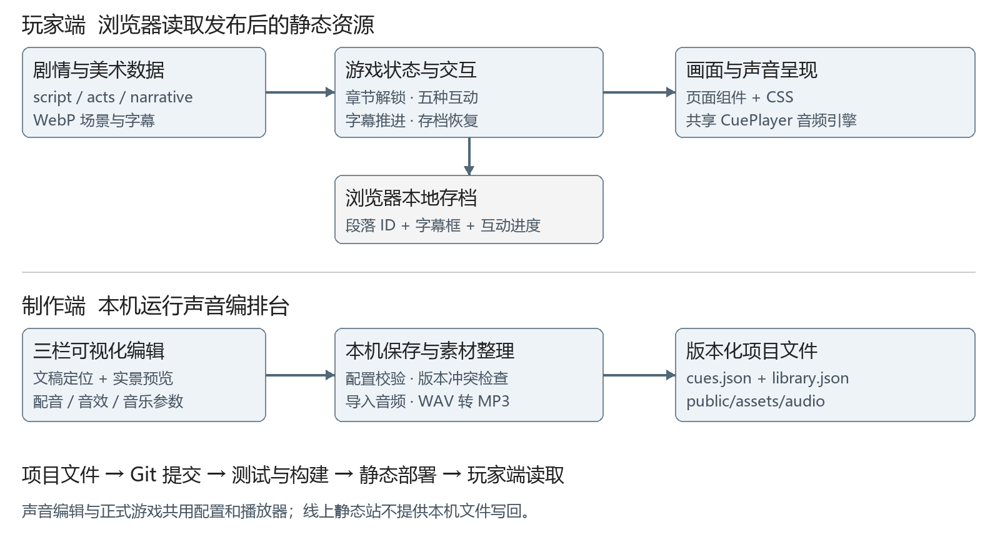
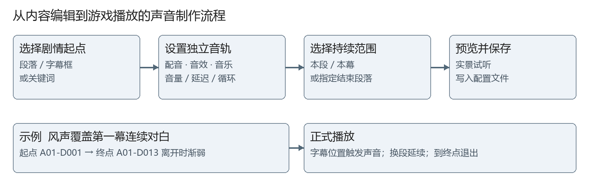

# 赤水行军图作品说明技术补充稿

供张郑卓丹转交周徽音与张子含使用  2026年10月20日

这份材料补充技术实现、工程难点和验证证据，供文书同学改写作品说明的创新点、实现方法、成果状态与学生贡献。判断基于当前本地代码和配置快照，正式提交前应再次核对发布版本。

### 先补具体实现和证据

现有作品说明约一万字，已覆盖定位、价值、创新、难点和展望。技术部分的主要缺口是没有解释机制，也没有提供可复核的图、字段、案例与测试结果。《智游无诈》报告可借鉴的是需求、设计、实现、验证之间的对应关系；其账号、数据库、AI 服务和184项历史测试不应直接套用到本项目。

| 优先级 | 建议交付的技术材料 | 在作品说明中的用途 |
| --- | --- | --- |
| 最高 | 声音编排台设计说明与制作流程图 | 补充音频制作工具与跨专业协作方法 |
| 最高 | 总体架构图与模块职责 | 说明网页游戏怎样运行和发布 |
| 高 | 剧情状态和存档机制说明 | 解释分幕、续读、修改剧本后的兼容 |
| 高 | 五种互动规则与反馈表 | 呈现具体游戏机制和叙事关系 |
| 高 | 资源优化与测试发布记录 | 用实际数据和检查结果支撑完成度 |
| 高 | 学生贡献和AI使用记录 | 说清决策、制作、审校与接入责任 |

### 当前可核实的成果口径

游戏正文为128段、249个字幕框，含73段出声对白、5段内心和50段旁白。配音交付范围为78条。核查时素材库有98项素材，其中78个文件名与全部待录段落ID对应；已启用46个声音绑定，包括19个配音、26个音效、1个音乐。文件入库不等于音质通过验收，也不等于已全部接入游戏。

本地已有可通关五幕、幕末札记、复盘、续读与声音编排功能；本次构建和自动流程检查通过。全部配音试听、多设备实测、史料审核与线上版本一致性仍需各负责人提供记录。后文给出可直接改写的文字及证据位置。

## 总体技术架构与选型

建议用于作品说明第四部分实现方法，在交互逻辑开发前增加总体架构说明。

图1  玩家端与本机制作端的职责。声音编排台的保存服务只在本机开发环境提供；发布站读取已生成的配置与资源。

### 可直接用于作品说明的文字

作品采用TypeScript、Vite与原生HTML/CSS实现网页交互叙事。剧情、章节、角色、场景与史料以独立数据文件维护，游戏状态负责章节解锁、对白位置和互动进度，视图组件负责画面呈现。浏览器本地存储保存阅读进度。正式体验端以静态文件部署，降低安装与服务器维护需求。

针对多专业团队的声音制作需求，项目另外实现本机声音编排台。编辑器通过真实游戏预览核对剧情位置，将声音参数保存为配置文件；编辑器与正式游戏共用播放器，减少制作预览和实际运行之间的差异。发布流程对源代码执行检查和构建，再部署生成的静态产物。

### 架构选择及其边界

本项目的核心任务是固定剧本的连续体验，因此采用本地存档与静态部署。当前没有账号系统、云端学习档案、服务端数据库或在线大模型对话。Vite插件承担本机制作工具的文件读写，不应写成玩家端业务后台。页面切换由游戏状态控制，未使用独立路由框架。

## 剧情引擎与五种互动

### 可直接用于作品说明的文字

剧情引擎分别记录逻辑段落和屏幕字幕框。正文保持稳定段落ID，长段按照字幕分行拆框显示；打字机效果支持点击补全，再次点击推进。进入转场或互动时限制误触，互动完成并确认后回到相应剧情位置。用户完成一幕并阅读幕末札记后进入下一幕，已解锁章节支持回看。

存档保存章节、段落书签、字幕框及互动进度。恢复时校验数据，并兼容旧版按下标保存的进度；新版剧本插入或重排段落时，以ID定位减少续读错位。当前保存的是浏览器本地进度，不能跨设备同步，也不承诺恢复到某个字或配音的某一毫秒。

### 互动规则及其叙事作用

| 幕次与互动 | 实际规则 | 可解释的叙事作用 |
| --- | --- | --- |
| 第一幕 雨夜架桥 | 先取门板，再依次铺设3处桥位 | 通过搬运和搭桥动作呈现渡河准备 |
| 第二幕 雾中寻路 | 4×4地图，沿相邻格寻找队伍，6步完成 | 以受限视野呈现夜行、迷失与跟随 |
| 第三幕 听令攀登 | 6段攀登，每段依次掩护、攀登、伏低、跟进 | 通过24次正确操作呈现协同与纪律 |
| 第四幕 转移伤员 | 先扶住战友，再向掩体移动，重复3次 | 把救援从旁观情节转为具体动作 |
| 第五幕 八步渡桥 | 连续确认8步前进 | 以慢速前进呈现夜渡的谨慎 |

上述作用是交互设计意图；是否提升理解与情绪投入，需要真人试玩验证。不能据此直接写成已证明的教育效果。

### 建议写入的工程难点

剧本增补使段落序号、字幕分框、小游戏位置和旧存档同时变化。项目使用段落ID作为内容关联标识，按ID确定互动插入点，以书签恢复阅读位置；自动流程检查覆盖重看、续读、幕末札记和通关。这个案例比笼统写“完成页面跳转和点击响应”更能体现程序工作。

证据位置：src/game.ts、src/subtitles.ts、src/typewriter.ts、src/data/acts.ts、tests/smoke.mjs。复盘使用四个可切换叙事节点与四次渡河方向示意，图形不是按真实坐标制作的地理地图。

## 声音编排台与音画同步

这是本项目目前最值得单独介绍的制作工具。它解决的问题是文稿、配音、音效和音乐频繁调整时，内容同学需要依赖程序同学逐条修改代码。其价值是可视化配置、实景试听与文件写回，不宜包装为新的音频算法。

### 可直接用于作品说明的文字

团队实现三栏声音编排台：左侧检索和定位剧本段落，中间显示真实游戏画面，右侧分别配置配音、音效和音乐。声音可绑定段落开始、指定字幕框或关键词显示位置，并设置延迟、截取、循环、速度及渐强渐弱。环境声和配乐支持从起始段落连续覆盖后续对白，在结束段落离开或指定关键词出现时退出。

播放器分别控制配音、音效与音乐音量，配音播放时按设置降低音乐音量；多个音效可叠加，新配音或音乐接替同类旧音轨。界面重绘与保存配置不会重复触发已经播放的声音，打开目录或切换到后台时暂停，进入小游戏、转场或札记时清理绑定声音。

编辑器以剧本指纹检查配置对应的文稿版本，以文件版本校验避免覆盖其他窗口的修改。合法配置自动写入项目，并保留上一版备份。预览使用独立进度，不覆盖玩家存档；配置和音频随项目提交、部署后进入正式体验。

### 写作时需要保留的边界

“音量均衡”在当前工具中指各轨增益调整，不是频段均衡器、自动响度归一或自动降噪；这些属于素材制作工作。关键词触发依据字幕显示位置，不是语音识别或强制对齐。跨段范围限同一幕连续对白，直接跳到中途不会自动重建此前的长音轨。

证据位置：src/studio/main.ts、src/sound/engine.ts、src/sound/schema.ts、tools/audio-studio-plugin.ts、public/audio/cues.json。

## 内容数据与资源优化

### 用稳定标识连接各项制作

| 数据对象 | 关键内容 | 解决的问题 |
| --- | --- | --- |
| 剧情段落 | id、speaker、text、sceneId、subtitleLines、inner | 同一段文稿可关联角色、字幕与配音 |
| 章节与互动 | dialogue、interaction、afterLine、sourceIds | 互动与幕末史料对应明确位置 |
| 声音绑定 | lineId、bus、asset、trigger、scope、endLineId | 声音触发点与跨段终点可独立修改 |
| 玩家存档 | bookmarks、frames、games、completed、version | 续读、章节解锁与旧版本迁移 |
| 素材与来源 | 素材路径、原文件名、版本与来源记录 | 区分网页资源、原素材与制作证据 |

### 已有优化数据

| 样本范围 | 优化前 | 优化后 | 体积减少 |
| --- | --- | --- | --- |
| 18张开篇和场景图片 | 11,457,540 字节 | 3,340,624 字节 | 约70.8% |
| 最初导入的8个WAV音效 | 51,337,382 字节 | 3,916,146 字节 | 约92.4% |

图片记录来自资源优化清单；音频记录只对应最初8个音效，不是当前98项素材的总体压缩率。体积下降不能直接写成页面速度提高同样百分比。首屏耗时和弱网表现仍需在实际发布地址测量。

### 可直接用于作品说明的文字

项目将原始美术和音频与网页发布资源分开管理。网页图像使用压缩后的静态WebP，浏览器通过缩放、遮罩和叠化呈现场景；访问过程中不会调用AI实时生成图片。当前场景与下一不同场景进行有限预取，音频播放器预取下一段最多两条配音，其余声音按触发加载。

素材工具支持扫描原素材目录或导入文件，在本机已配置FFmpeg时将WAV转换为MP3，保留源文件并更新素材清单。网页资源使用内容哈希命名，降低同名覆盖和路径混淆。音频加载或播放失败时，文字剧情仍可推进。

证据位置：docs/asset-optimization.json、src/sound/preload.ts、src/main.ts、tools/audio-library.mjs。原说明“进入某幕才加载整幕音频”应改成上述实际策略。

## 测试结果与发布交付

2026年10月20日本次核查重新运行 npm run smoke 与 npm run build，均通过。日志已保存，结果对应当前本地工作区；不能据此推定GitHub上的版本与本地一致。

| 验证项目 | 本次可报告的证据 | 不能据此推导 |
| --- | --- | --- |
| 剧情流程 | 脚本完整性、字幕分框、五种互动、札记、复盘、完整通关检查通过 | 所有设备和所有操作组合均无缺陷 |
| 续读与迁移 | 重看、存档恢复、旧进度兼容等自动检查通过 | 跨设备云存档或逐字逐毫秒恢复 |
| 音频规则 | 关键词、去重、暂停、三轨音量、跨段连续、终点渐弱等检查通过 | 所有配音的内容、音质、时长均已验收 |
| 生产构建 | TypeScript检查及Vite打包通过 | 真实网络访问速度与线上部署成功 |
| 真人体验 | 目前应补充设备、人数、卡点和改进记录 | 已开展四轮测试或已证明学习效果 |
| 史实审核 | 代码保留出处与待核状态 | 全部史料页码和美术细节已复核 |

### 发布流程怎样写

仓库配置GitHub Actions：主分支更新后安装依赖，执行自动流程检查与生产构建，随后发布dist目录到GitHub Pages。当前有本地未提交修改，发布前应确认提交号、Actions运行结果、线上配置与演示截图属于同一版本。

应保存的发布证据包括：最终Git提交号、Actions成功记录、真实访问链接、桌面与手机完整试玩记录、加载失败或弱网检查结果。作品说明中的网址应使用普通半角连字符 chishui-march，避免排版字符导致链接错误；此处未验证线上当前版本。

### 剩余时间最有价值的补测

邀请5至8位实际体验者完整试玩，记录设备与浏览器、开始结束时间、无法理解或需要帮助的位置，并设置3个关于反复渡河的理解问题。这是建议实施的测试，不写成已完成；报告应同时记录负面反馈、修复内容与复测结果。

证据位置：tests/smoke.mjs、tests/audio.mjs、.github/workflows/deploy.yml、docs/technical-evidence/2026-10-20-local-validation.txt。

## 原作品说明的具体修订建议

下面按原说明的章节定位问题。已实现内容应增加机制与证据，尚无充分记录的内容改为当前状态或待验证事项。

| 原说明位置与表述 | 建议修改方向 |
| --- | --- |
| 二 视听创新 “所有出场历史人物均有专属配音” | 说明6名文学创作角色的差异化声音设计。当前78条文件已入库，19段已绑定；后续按最终配置更新数字，不将文件存在等同于全部试听通过。 |
| 二 体验逻辑 “游戏化只体现在叙事流程引导” | 补入架桥、寻路、攀登、救援、渡桥五种具体互动，说明操作、反馈和叙事作用。章次解锁本身不宜宣称技术首创。 |
| 三 多端难点 “建立多设备测试池，兼容微信等主流浏览器” | 提供实际设备、系统、浏览器版本与记录；已有响应式布局可以写，尚未实测的设备写为待验证。 |
| 三 音频性能 “进入对应幕次才加载本幕音频” | 改为下一段有限配音预取、其余按触发加载；区分声音播放器功能与素材是否完成接入。 |
| 四 视觉制作 “AI只作参考，所有素材均重绘后使用” | 逐项列明实际生成、筛选、修图和压缩过程。压缩或路径整理不等同于人工重绘；有证据的修改才写。 |
| 四 测试迭代 “已完成四轮测试并修正所有问题” | 改成已执行的自动检查与实际测试记录；真人、跨设备、史实审校未提供证据时列为提交前任务。 |
| 五 成果状态 “全部功能落地，全部配音完成，调试完毕” | 采用可演示版本、工具已实现、素材制作与绑定进度、待验收项四类状态。用最终版本记录支持完成度。 |
| 九 作品展望 “增加复盘地图和权威资料跳转” | 现有复盘已有交互方向示意图与延伸阅读链接；可改为细化真实地理点位、扩大史料覆盖等后续工作。 |

涉及史实“完全可靠”、多轮师生审校、“有效增强理解”等表述，应由内容审核和真实研究记录支持。源码只能说明功能如何实现，不能替代这些证据。

## 学生贡献与材料交接

### 技术贡献可以具体写成什么

建议张郑卓丹按实际参与记录说明：明确网页游戏和本机制作工具的边界；确定段落ID及字幕分框的数据约定；组织剧本修订与史实时序校正接入；设计可视化声音编排需求；完成或组织代码集成、问题复现、测试与发布验收。每项工作补一份对应的需求记录、代码变更、修复截图或测试日志。

现有工作使用AI参与代码生成与修改、排错、测试脚本和文档整理，因此不宜仅写“AI辅助少量代码片段调试”。可如实写为“团队提出需求、确定功能取舍与验收标准，使用AI辅助实现和排错，并对生成结果进行运行验证、内容审校与整合”；具体成员的独立编码范围以实际记录为准。

### 可直接用于作品说明的成果状态段落

目前已形成可运行的五幕交互叙事版本，包含128段正文、249个字幕框、五种互动、幕末史料札记、全局复盘与本地续读。项目另实现本机声音编排台，支持配音、音效、音乐独立配置及跨段播放。本地自动流程检查和生产构建通过；声音素材已入库，正在完成剧情绑定、混音试听与最终发布验收。

### 交给文书同学的六项材料

本稿第2至7页分别提供架构、互动、声音工具、资源、测试和表述核对。配套架构图、声音流程图、资源记录及本次测试日志已存入项目文档目录；需补齐的实景截图和最终发布记录由各负责人交接。

周徽音提炼作品定位、视听设计与声音制作流程；张子含核对史料、人物设定、统计口径和文书状态；袁艺航补齐美术与声音编排截图及实际加工记录；张郑卓丹确认架构、互动规则、测试和部署证据。以上为建议交接安排，个人完成情况由本人确认。

### 本稿核对依据

团队提供的《赤水行军图-作品说明(1).docx》与《第五组-智游无诈-课程设计报告.docx》；当前本地src、tools、tests、public/audio配置和GitHub Actions配置；本次测试日志及资源优化清单。对照报告的研究结果仅作为写作方法参考，不计入本项目成果。

这份技术稿可作为附件，正文择要吸收机制、案例与结果。提交前应将原说明中关于背景与价值的重复段落合并，把篇幅留给图、操作流程、真实数据与验证记录。
